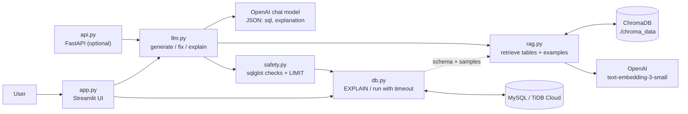

# AI SQL Assistant

Ask questions about a MySQL database in plain English. The app finds the relevant tables (RAG),
writes **one read-only SQL query** with OpenAI, explains it, checks it with `EXPLAIN` (and fixes it
if it fails), runs it safely, and shows the results as a table and chart.

Built with Python, Streamlit, FastAPI, SQLAlchemy, MySQL / TiDB Cloud, OpenAI, ChromaDB and sqlglot.

## Features

- **Schema-aware RAG**: one ChromaDB document per table (columns, types, primary/foreign keys, up to 3 sample
  values per column; columns like `email`/`phone`/`password`/`token` get no samples). The question is embedded,
  the top-5 tables are retrieved, and tables linked by a foreign key (1 hop) are added. Only those tables go to the LLM.
  The index is rebuilt only when the schema hash changes (or on **Re-index**).
- **Few-shot examples**: the 3 most similar question→SQL pairs (seeded from `few_shot.json`) are added to the prompt.
  👍 on a result saves it as a new example.
- **Structured generation**: the model returns JSON `{sql, explanation, tables_used}`; the explanation is shown before running.
- **Self-correction**: generated SQL is checked with `EXPLAIN`; on error, the SQL + MySQL error go back to the model (max 3 attempts, shown in an expander).
- **Safety** (sqlglot): exactly one statement; only `SELECT`, `WITH…SELECT`, `SHOW`, `DESCRIBE`, `EXPLAIN`; auto `LIMIT 100`; 10 s timeout.
- **Two connection modes**: the demo database (from secrets/.env) or *Connect my own* (host, port, user, password, database, SSL).
- **Results**: table, CSV download, automatic chart (text + number → bar, date + number → line), last-20 query history.
- **Evaluation**: `eval.py` measures execution accuracy on 30 questions, full-schema vs RAG + few-shot.

## Architecture



**Request flow:** question → embed → top-k tables + FK neighbours + 3 examples → LLM returns JSON →
sqlglot validation → `EXPLAIN` (retry with the error up to 3×) → user reviews/edits SQL → validated again → run with timeout → table + chart.

## Files

| File | Purpose |
|---|---|
| `app.py` | Streamlit UI (calls the functions below directly) |
| `api.py` | Optional thin FastAPI wrapper over the same functions (demo database) |
| `db.py` | Config (st.secrets → .env), MySQL connection (SSL optional), schema reading, query execution |
| `rag.py` | ChromaDB: schema index (hash-based re-index), table retrieval + FK expansion, few-shot examples |
| `llm.py` | OpenAI prompts: generate SQL (JSON), self-correct, explain |
| `safety.py` | sqlglot read-only validation + auto `LIMIT 100` (`python safety.py` shows examples) |
| `few_shot.json` | 10 seed question→SQL examples for the demo database |
| `eval.py` | Evaluation script (execution accuracy, tokens, latency) |
| `eval_questions.json` | 30 test questions with gold SQL (easy / joins / aggregation / dates) |

## Setup (local)

The demo database is MySQL's free **classicmodels** sample database (customers, orders, payments, products, employees, offices).
Load `mysqlsampledatabase.sql` from mysqltutorial.org in MySQL Workbench (File → Open SQL Script → ⚡ run).

```bash
python -m venv venv
venv\Scripts\activate          # macOS/Linux: source venv/bin/activate
pip install -r requirements.txt
copy .env.example .env         # macOS/Linux: cp .env.example .env
```

Edit `.env`:

| Setting | Example |
|---|---|
| `MYSQL_HOST`, `MYSQL_PORT` | `localhost`, `3306` |
| `MYSQL_USER`, `MYSQL_PASSWORD` | a read-only user (see below) |
| `MYSQL_DATABASE` | `classicmodels` (empty = all non-system databases) |
| `MYSQL_SSL` | `false` locally, `true` for TiDB Cloud |
| `OPENAI_API_KEY`, `OPENAI_MODEL` | your key, `gpt-4o-mini` |

Run:

```bash
streamlit run app.py
```

Optional REST API (open http://127.0.0.1:8000/docs):

```bash
uvicorn api:app --reload
```

## Deploy on Streamlit Community Cloud + TiDB Cloud

Only the secrets change; the code is the same.

1. **Create the database**: sign up at tidbcloud.com → create a free *Serverless* cluster → **Connect** → note the
   host, port (`4000`), user (looks like `xxxx.root`) and password.
2. **Load the demo data**: run `mysqlsampledatabase.sql` against TiDB (MySQL Workbench works: new connection with the
   TiDB host/port/user, enable SSL "Require").
3. **Push this repo to GitHub** (`.env` and `.streamlit/secrets.toml` are git-ignored).
4. At share.streamlit.io → **Create app** → pick the repo, branch `master`, main file `app.py`.
   Under *Advanced settings* choose Python 3.11 and paste the secrets:

   ```toml
   MYSQL_HOST = "gateway01.<region>.prod.aws.tidbcloud.com"
   MYSQL_PORT = "4000"
   MYSQL_USER = "<prefix>.root"
   MYSQL_PASSWORD = "<password>"
   MYSQL_DATABASE = "classicmodels"
   MYSQL_SSL = "true"
   OPENAI_API_KEY = "sk-..."
   OPENAI_MODEL = "gpt-4o-mini"
   ```

5. Deploy. On Linux, `pysqlite3-binary` is installed and `app.py` swaps it in for the old system `sqlite3` that ChromaDB can't use.

> Streamlit Cloud's disk is temporary: `chroma_data/` is rebuilt automatically after a restart (a few cents of
> embeddings), and examples added with 👍 are lost on restart.

## Evaluation

```bash
python eval.py            # all 30 questions, both modes (~3 minutes)
python eval.py --limit 5  # quick check
```

**Metric: execution accuracy.** The generated SQL counts as correct if it returns the same rows as the gold SQL
(order-insensitive, numbers to 2 decimals, column names ignored). Generated and gold SQL both go through the same
safety layer. Few-shot examples come from a clean copy of `few_shot.json`, so 👍 clicks can't leak answers into the test.

Results on classicmodels (8 tables), `gpt-4o-mini`, temperature 0, 30 questions (run 2026-11-24):

| Metric | Full schema | RAG + few-shot |
|---|---:|---:|
| Execution accuracy | **96.7%** (29/30) | **96.7%** (29/30) |
| — easy (8) | 100% | 100% |
| — joins (8) | 87.5% | 87.5% |
| — aggregation (7) | 100% | 100% |
| — dates (7) | 100% | 100% |
| Avg prompt tokens | 1,904 | 1,814 (−4.7%) |
| Avg latency | 2.52 s | 2.94 s |
| Avg tables sent | 8 | 7.1 |
| Gold tables included in prompt | 100% | 100% |
| Queries fixed by self-correction | 1 | 0 |

**What the numbers say:**
- Both modes miss the same question ("for each sales rep…"): the model listed all 23 employees (including the President with 0 customers) instead of only sales reps.
- On a schema this small, RAG keeps accuracy the same and saves only ~5% tokens. classicmodels is highly connected, so top-5 + foreign-key neighbours still pulls in ~7 of 8 tables. The embedding call adds ~0.4 s.
  RAG matters more as schemas grow: with hundreds of tables the full schema doesn't fit in a prompt at all.
- Self-correction rescued one query in full-schema mode (it failed `EXPLAIN` on the first try).

Full per-question output is saved to `eval_results.json` (git-ignored; re-run to regenerate).

## Security notes

- SQL is parsed with sqlglot, not regex: exactly one statement, and only `SELECT` / `WITH…SELECT` / `SHOW` / `DESCRIBE` / `EXPLAIN`.
  Write clauses anywhere in the tree (`INSERT`, `UPDATE`, `DELETE`, DDL, `SELECT … INTO`, `FOR UPDATE`) and risky functions
  (`LOAD_FILE`, `SLEEP`, `BENCHMARK`) are rejected with a clear reason. Unparseable SQL is rejected (fail closed).
- `LIMIT 100` is added to `SELECT` queries that have no limit; queries time out after 10 s (`max_execution_time`).
- *Connect my own* blocks hosts that resolve to loopback/private/link-local addresses (127.x, 10.x, 172.16–31.x, 192.168.x,
  169.254.x), so the hosted app can't be used to probe internal networks. Credentials live only in `st.session_state`
  and are never logged or saved. Their schema index and 👍 examples are kept in memory only (never written to disk)
  and are dropped when the user connects to a different database.
- After connecting, the app reads the user's own permissions (`SHOW GRANTS`) and shows a ⚠️ warning if the user can
  change data (INSERT, UPDATE, DELETE, DROP, ALL, …), recommending a read-only user instead.
- Table/column names and a few sample values are sent to OpenAI to generate SQL (shown in the UI).
- `.env` and `.streamlit/secrets.toml` are git-ignored. Never commit real keys or passwords.

### Use a read-only MySQL user (recommended)

App-level checks are one layer; the database should be the second. Create a user that can only read:

```sql
CREATE USER 'sql_assistant_ro'@'%' IDENTIFIED BY 'choose-a-strong-password';
GRANT SELECT, SHOW VIEW ON classicmodels.* TO 'sql_assistant_ro'@'%';
FLUSH PRIVILEGES;
```

Then put this user in `MYSQL_USER` / `MYSQL_PASSWORD`. Even if a bad query slipped past the app, MySQL itself would refuse to change data.
