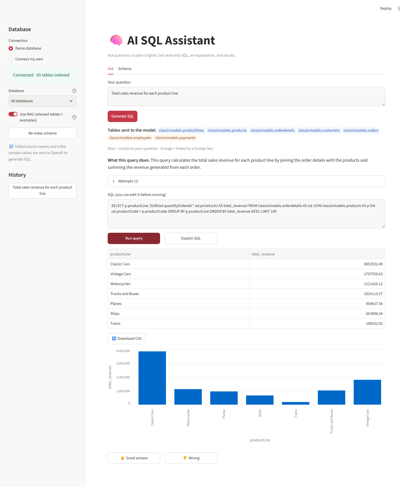
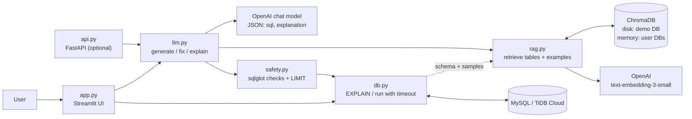

# 🧠 AI SQL Assistant

[](https://github.com/Arjav122/AI-Powered-SQL-Query-Generator-Executor-/actions/workflows/tests.yml)

Ask questions about a MySQL database in plain English and get a **safe, read-only SQL query**, a plain-English
explanation, and the results as a table and chart.

The app finds the relevant tables with **RAG** (ChromaDB + OpenAI embeddings), writes the query with an OpenAI
chat model, checks it against the real database with `EXPLAIN` (and fixes it if it fails), and blocks anything that
could change data.

**96.7% execution accuracy** on a 30-question benchmark. On a 65-table schema, RAG cut prompt tokens by **78%**
(9,263 → 2,033) and scored 96.7% in every run, while sending the full schema varied between 90.0% and 96.7%
([results](#-evaluation-results)).

**Tech:** Python 3.11 · Streamlit · FastAPI · SQLAlchemy + PyMySQL · MySQL / TiDB Cloud · OpenAI (`gpt-4o-mini`,
`text-embedding-3-small`) · ChromaDB · sqlglot · pandas · pytest · GitHub Actions



---

## ✨ Features

| Area | What it does |
|---|---|
| **Schema-aware RAG** | Indexes one ChromaDB document per table (columns, types, primary/foreign keys, up to 3 sample values per column). For each question it retrieves the top-5 tables, adds tables linked by a foreign key (1 hop), and sends **only those** to the LLM. A schema hash means it re-indexes only when the structure changes. |
| **Few-shot examples** | Adds the 3 most similar question→SQL examples to the prompt (seeded from `few_shot.json`). 👍 on a good result saves it as a new example. |
| **Structured output** | The model returns JSON `{sql, explanation, tables_used}`; the explanation is shown before you run anything. |
| **Self-correction** | Generated SQL is checked with `EXPLAIN`. If MySQL rejects it, the SQL + error go back to the model (max 3 attempts, all shown in the UI). |
| **Clarifying questions** | If a request is too ambiguous to answer without guessing, the model asks one short question instead of writing SQL. |
| **Safety** | sqlglot parsing: exactly one statement, only `SELECT` / `WITH…SELECT` / `SHOW` / `DESCRIBE` / `EXPLAIN`; auto `LIMIT 100`; 10-second timeout. |
| **Two connection modes** | *Demo database* (from `.env` / secrets) or *Connect my own* (host, port, user, password, database, SSL). |
| **Results** | Table, CSV download, automatic chart (text + number → bar, date + number → line). |
| **History** | Last 20 questions per database in the sidebar; click to reload. |
| **Database filter** | Sidebar dropdown: *All databases* or one database. Retrieval, full-schema mode and few-shot examples are limited to the chosen database, so a similar table in another database can't be picked. |
| **RAG toggle** | Turn RAG off to compare against sending the full schema. |
| **Schema browser** | Databases → tables → columns (type, key, nullable). |
| **REST API** | Optional FastAPI wrapper over the same functions (`/docs`). |
| **Evaluation** | `eval.py` measures execution accuracy, prompt tokens and latency, full schema vs RAG + few-shot. |
| **Tests + CI** | 40 pytest unit tests (safety, SSRF blocking, permission check, retrieval, self-correction, eval scoring) run on every push with GitHub Actions. No database or API key needed. |

## 🏗️ Architecture



**How a question is answered**

1. The question is embedded (`text-embedding-3-small`).
2. ChromaDB returns the 5 most similar tables; tables linked by a foreign key are added; the 3 most similar examples are added.
3. The chat model returns JSON with the SQL, an explanation and the tables used.
4. `safety.py` validates the SQL with sqlglot and adds `LIMIT 100` if needed.
5. `EXPLAIN` checks it against the real schema. On error, the model gets the error and tries again (up to 3 times).
6. You review or edit the SQL. When you click **Run**, it is validated again and runs with a 10-second timeout.
7. The results are shown as a table, a CSV download and a chart.

## 📁 Project structure

```
├── app.py               Streamlit UI (calls the functions below directly)
├── api.py               Optional thin FastAPI wrapper (demo database)
├── db.py                Config, MySQL connection (SSL optional), schema reading, safe query execution
├── rag.py               ChromaDB: schema index, table retrieval + FK expansion, few-shot examples
├── llm.py               OpenAI prompts: generate SQL (JSON), self-correct, explain
├── safety.py            sqlglot read-only validation + auto LIMIT  (python safety.py shows examples)
├── few_shot.json        10 seed question→SQL examples for the demo database
├── eval.py              Evaluation script
├── eval_questions.json  30 test questions with gold SQL
├── eval_results.json    Latest evaluation output (per-question details)
├── city_hospital.sql    Generated 51-table demo database, used as distractors in the large-schema test
├── test_project.py      pytest unit tests
├── screenshot.png       App screenshot (above)
├── requirements.txt     Pinned dependencies
├── .env.example         Settings template
├── .github/workflows/tests.yml   CI: runs the tests on every push
└── .gitignore
```

## 🧪 Tests

```bash
pip install pytest
pytest -q          # 40 tests, about 2 seconds, no database or OpenAI key needed
```

The tests cover the safety layer (allowed and blocked queries, auto LIMIT), SSRF blocking, the write-permission
check, retrieval with foreign-key expansion and the database filter (in-memory ChromaDB with fake embeddings), the
self-correction loop and clarifying questions (model calls mocked), and the evaluation's result comparison.

## 🚀 Run locally

**1. Load the demo database.** The demo uses MySQL's free **classicmodels** sample database (customers, orders,
order details, payments, products, product lines, employees, offices). Download `mysqlsampledatabase.zip` from
mysqltutorial.org, unzip it, then in MySQL Workbench open `mysqlsampledatabase.sql` (File → Open SQL Script) and click ⚡.

**2. Install.**

```bash
python -m venv venv
venv\Scripts\activate            # macOS/Linux: source venv/bin/activate
pip install -r requirements.txt
copy .env.example .env           # macOS/Linux: cp .env.example .env
```

**3. Configure `.env`.**

| Setting | Example | Notes |
|---|---|---|
| `MYSQL_HOST` / `MYSQL_PORT` | `localhost` / `3306` | |
| `MYSQL_USER` / `MYSQL_PASSWORD` | `sql_assistant_ro` / … | Use a read-only user ([how](#use-a-read-only-mysql-user)) |
| `MYSQL_DATABASE` | empty | Empty = all non-system databases (pick one in the sidebar). Set one name to lock the app to that database. |
| `MYSQL_SSL` | `false` | `true` for TiDB Cloud |
| `OPENAI_API_KEY` | `sk-…` | |
| `OPENAI_MODEL` | `gpt-4o-mini` | Any OpenAI chat model with JSON mode |

Settings are read from Streamlit secrets (`.streamlit/secrets.toml`) first, then from `.env`.

**4. Start.**

```bash
streamlit run app.py
```

Optional REST API (then open http://127.0.0.1:8000/docs):

```bash
uvicorn api:app --reload
```

**Try asking:** *"Total sales for each product line"* (bar chart) · *"Total payments for each year"* (line chart) ·
*"Which customers have never placed an order?"* · *"Delete all customers"* (refused).

## 🔌 Connecting your own database

| Where the app runs | Your database | How |
|---|---|---|
| Your computer | MySQL on your computer (e.g. the one you use in Workbench) | Put its details in `.env` → **Demo database** mode |
| Streamlit Cloud | A cloud MySQL (TiDB Cloud, AWS RDS, Azure, Aiven…) | **Connect my own** in the sidebar |
| Streamlit Cloud | MySQL on someone's laptop | ❌ Not reachable from the internet. Copy the data to a cloud database first. |

In *Connect my own* mode:

- Hosts that resolve to local/private addresses (`localhost`, 127.x, 10.x, 172.16–31.x, 192.168.x, 169.254.x) are blocked, so the hosted app can't be used to reach internal networks (SSRF).
- The connection is tested with `SELECT 1`. The app then reads the user's own permissions (`SHOW GRANTS`) and shows a ⚠️ warning if the account can change data.
- Every feature works the same: RAG, the Database filter, safety, self-correction, charts and history. Few-shot examples start empty and grow with 👍.
- The password lives only in the browser session. The schema index and examples are kept **in memory only**, never written to disk, and are dropped when you connect to a different database.

## ☁️ Deploy (Streamlit Community Cloud + TiDB Cloud)

Only the secrets change; the code stays the same.

1. **Create the database.** At tidbcloud.com, create a free *Serverless* cluster → **Connect** → copy the host, port (`4000`), user (`xxxx.root`) and password.
2. **Load the demo data.** In MySQL Workbench, add a connection with those details (SSL: *Require*) and run `mysqlsampledatabase.sql`.
3. **Push this repo to GitHub.** `.env` and `.streamlit/secrets.toml` are git-ignored.
4. **Create the app.** At share.streamlit.io → **Create app** → pick the repo, branch `master`, main file `app.py`.
   Under *Advanced settings*, choose **Python 3.11** and paste:

   ```toml
   MYSQL_HOST = "gateway01.<region>.prod.aws.tidbcloud.com"
   MYSQL_PORT = "4000"
   MYSQL_USER = "<prefix>.root"
   MYSQL_PASSWORD = "<password>"
   MYSQL_DATABASE = "classicmodels"
   MYSQL_SSL = "true"
   OPENAI_API_KEY = "sk-..."
   OPENAI_MODEL = "gpt-4o-mini"
   ```

5. **Deploy.** On Linux, `pysqlite3-binary` is installed and `app.py` swaps it in for the old system `sqlite3`, which ChromaDB can't use.

> Streamlit Cloud's disk is temporary. `chroma_data/` rebuilds automatically after a restart (about 1 cent of
> embeddings), but examples saved with 👍 are lost.

## 📊 Evaluation results

```bash
python eval.py            # all 30 questions, both modes (~3 minutes, a few cents)
python eval.py --limit 5  # quick check
```

**Metric: execution accuracy.** A generated query is correct if it returns the same rows as the gold query
(order-insensitive, numbers compared to 2 decimals, column names ignored). This is the standard text-to-SQL metric
used by the Spider benchmark. Both queries go through the same safety layer. The few-shot examples come from a clean
copy of `few_shot.json`, so 👍 clicks can't leak test answers into the evaluation.

Two experiments, same 30 questions (all about classicmodels), `gpt-4o-mini`, temperature 0, run 2026-11-24:

- **Small schema:** only classicmodels (8 tables), `MYSQL_DATABASE=classicmodels`.
- **Large schema:** classicmodels plus 57 unrelated tables (the generated 51-table `city_hospital` database from
  [`city_hospital.sql`](city_hospital.sql), plus two tiny databases), 65 tables in total, `MYSQL_DATABASE=` (empty).
  The extra tables act as distractors, like a real company database where most tables are irrelevant to any one question.

| Metric | Small: full schema | Small: RAG | **Large: full schema** | **Large: RAG** |
|---|---:|---:|---:|---:|
| **Execution accuracy (latest run)** | 96.7% | 96.7% | 96.7% | **96.7%** |
| Accuracy across 3 large-schema runs | — | — | 93.3% · 90.0% · 96.7% | **96.7% · 96.7% · 96.7%** |
| Easy (8) | 100% | 100% | 100% | 100% |
| Joins (8) | 87.5% | 87.5% | 87.5% | 87.5% |
| Aggregation (7) | 100% | 100% | 100% | 100% |
| Dates (7) | 100% | 100% | 100% | 100% |
| Avg prompt tokens | 1,904 | 1,814 | 9,263 | **2,033 (−78%)** |
| Avg latency | 2.52 s | 2.94 s | 2.96 s | 2.84 s |
| Avg tables sent | 8 | 7.1 | 65 | **8.6** |
| Needed tables included in prompt | 100% | 100% | 100% | 100% |
| Queries fixed by self-correction | 1 | 0 | 0 | 0 |

**What the numbers say**

- **RAG scales.** As the schema grew from 8 to 65 tables, full-schema prompts grew about 5× (1,904 → 9,263 tokens), while RAG prompts stayed almost flat (1,814 → 2,033) because it still sends only about 9 tables. On a large schema that is a **78% token (cost) saving**, with the needed tables retrieved 100% of the time.
- **RAG is more stable.** RAG scored 96.7% in all three large-schema runs. Full schema varied between 90.0% and 96.7%: in two runs it answered *"total payment amount received in each year"* from `city_hospital.invoices` instead of `classicmodels.payments`, and once it joined the wrong table for *"average credit limit per country"*. RAG never saw the hospital tables.
- **The accuracy gap is small.** On 30 questions, one or two answers is 3–7 percentage points, so the token saving and stability are the stronger results; proving an accuracy gain needs a larger benchmark with look-alike tables.
- **The one miss in every run:** *"For each sales rep, show … the number of customers they manage."* The model listed all 23 employees (including the President with 0 customers) instead of only sales reps.
- **Clarifying questions** (added before the third run) never fired on the benchmark questions, so the feature does not over-ask on clear questions.
- **Latency** is about the same: RAG adds an embedding call but sends a much smaller prompt.
- **Small schemas.** With only 8 highly connected tables, RAG matches full-schema accuracy and saves just 5%, because top-5 + foreign-key neighbours already covers most tables.

**Reproduce the large-schema run:** load `city_hospital.sql` in MySQL Workbench (it creates only the new
`city_hospital` database), set `MYSQL_DATABASE=` (empty), then run `python eval.py`. Per-question details for the
latest run are in [`eval_results.json`](eval_results.json).

## 🔒 Security

Defense in depth: no single layer has to be perfect.

| Layer | Protection |
|---|---|
| Prompt | The model is told to write only read-only SQL and to refuse requests to change data. |
| sqlglot | One statement only; only `SELECT` / `WITH…SELECT` / `SHOW` / `DESCRIBE` / `EXPLAIN`. Write clauses anywhere in the tree (`INSERT`, `UPDATE`, `DELETE`, DDL, `SELECT … INTO`, `FOR UPDATE`) and risky functions (`LOAD_FILE`, `SLEEP`, `BENCHMARK`) are rejected. Unparseable SQL is rejected (fail closed). |
| Limits | `LIMIT 100` added automatically; `max_execution_time` = 10 s. |
| Network | User connections to local/private IPs are blocked (SSRF protection). |
| Database | A read-only MySQL user means the database itself refuses any change (recommended below; the app warns if the user can write). |
| Privacy | Passwords stay in session memory and are never logged. User schemas are never written to disk. Secrets files are git-ignored. Table/column names and a few sample values are sent to OpenAI (shown in the UI); columns like email, phone, password and token get no samples. |

### Use a read-only MySQL user

```sql
CREATE USER 'sql_assistant_ro'@'%' IDENTIFIED BY 'choose-a-strong-password';
GRANT SELECT, SHOW VIEW ON classicmodels.* TO 'sql_assistant_ro'@'%';
FLUSH PRIVILEGES;
```

Put this user in `MYSQL_USER` / `MYSQL_PASSWORD`. Even if a bad query slipped past the app, MySQL would refuse to change data.

## 🧭 Design decisions

- **Plain Python instead of LangChain/LangGraph.** The pipeline (retrieve → generate → validate → retry) is about 50 lines. Writing it directly keeps every step visible and easy to debug, and avoids a heavy dependency for little gain.
- **Streamlit calls the functions directly.** Streamlit Cloud runs a single process, so the UI doesn't depend on a separate API server. FastAPI stays as an optional thin wrapper over the same code.
- **sqlglot instead of regex.** Parsing understands the query's structure (two statements, hidden write clauses), and a column named `updated_at` is no longer blocked by mistake.
- **`EXPLAIN` for self-correction.** It checks the query against the real schema without running it, and the error message tells the model exactly what to fix.
- **One document per table, plus foreign-key expansion.** A table is the unit the model needs; following foreign keys adds the tables a JOIN requires even when they aren't textually similar to the question.

## ⚠️ Limitations

- Only MySQL-compatible databases (MySQL, TiDB, MariaDB).
- Clarifying questions only fire for clearly ambiguous requests; a misread term (the "sales rep" miss) can still slip through.
- The benchmark is small (30 questions). The large-schema test uses generated distractor tables, not a real production schema.
- On Streamlit Cloud, 👍 examples are lost when the app restarts. User connections stay in server memory until the user switches database or the app restarts.

## 🔮 Future work

- Rerank retrieved tables (cross-encoder or LLM) for very large schemas.
- Store 👍 examples in a database so they survive restarts.
- A larger benchmark (e.g. a Spider subset) to measure RAG on big schemas.
